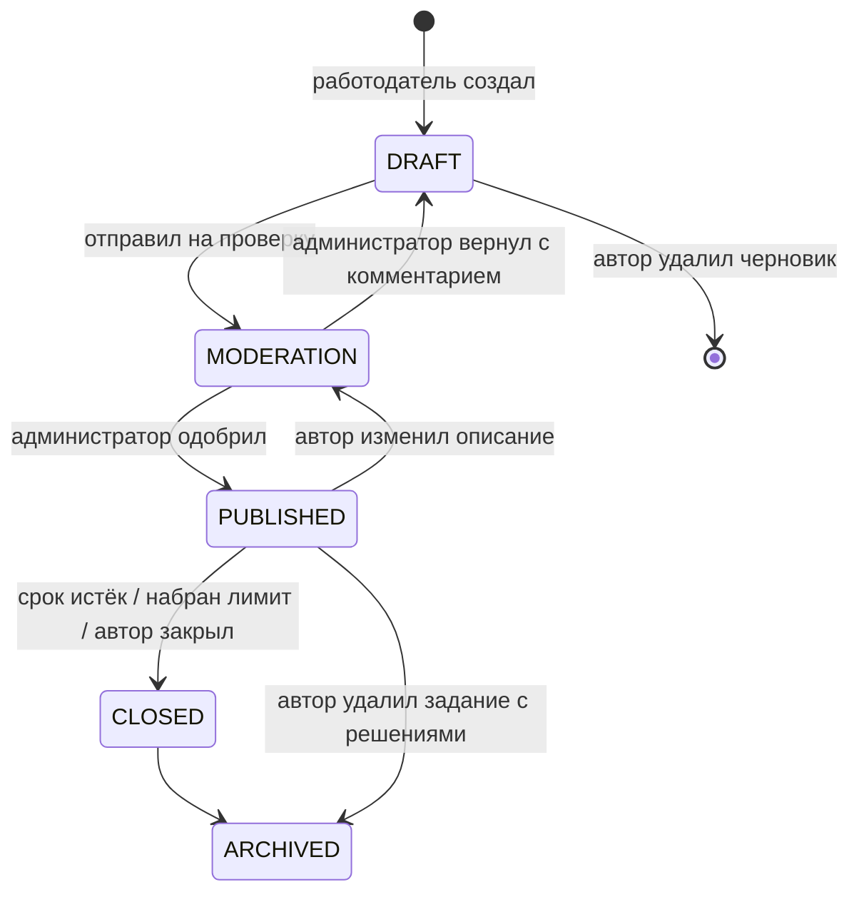
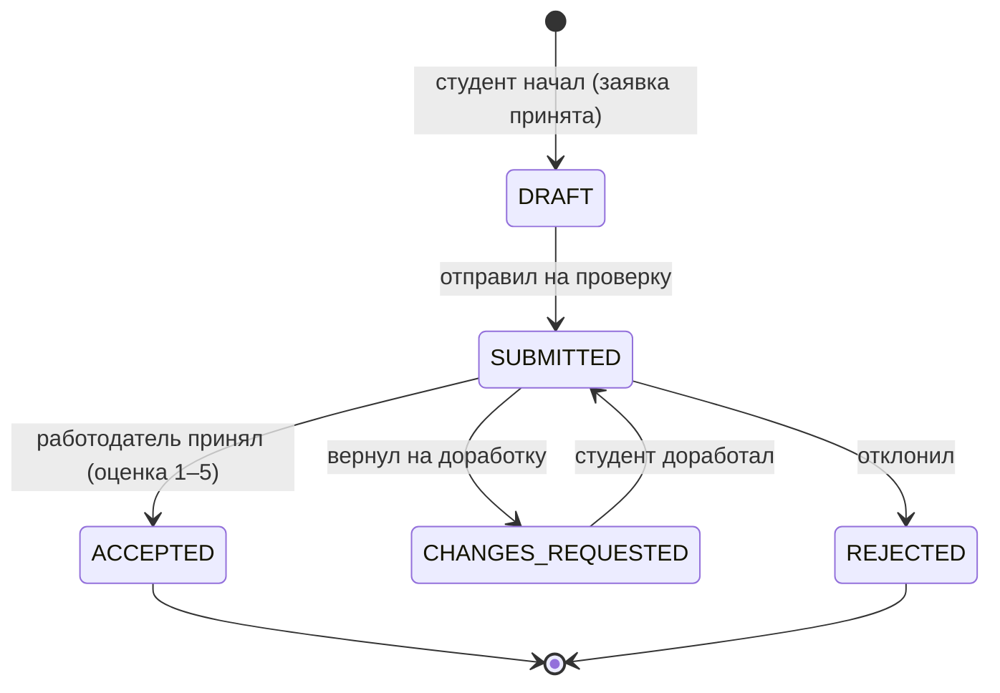

# 2. Модель данных

Источник истины — [`prisma/schema.prisma`](../prisma/schema.prisma). Изменения схемы вносятся только миграциями (`bun run db:migrate`), и каждая миграция хранится в репозитории в `prisma/migrations`.

## 2.1 Центральная сущность — задание

**Задание** — единица работы, которую организация предлагает студентам. Это не вакансия и не проект целиком: у задания есть ожидаемый результат, критерии оценки, срок, сложность, лимит участников и условия использования результата. **Решение** — результат работы одного студента по одному заданию. **Заявка** — согласие работодателя на то, что студент берётся за задание.

## 2.2 ER-диаграмма

```mermaid
erDiagram
    User ||--o| StudentProfile : "есть у студента"
    User ||--o| EmployerProfile : "есть у работодателя"
    Organization ||--o{ EmployerProfile : "сотрудники"
    Organization ||--o{ Task : "публикует"
    User ||--o{ Task : "автор"
    Task }o--o{ Tag : "теги"
    Task ||--o{ TaskStatusChange : "история"
    User ||--o{ Favorite : ""
    Task ||--o{ Favorite : "отслеживают"
    User ||--o{ Application : ""
    Task ||--o{ Application : "заявки"
    User ||--o{ Submission : ""
    Task ||--o{ Submission : "решения"
    Submission ||--o{ SubmissionFile : "файлы"
    Submission ||--o{ SubmissionStatusChange : "история"
    Task }o--o{ Competency : "развивает"
    StudentProfile }o--o{ Competency : "интересы"
    User ||--o{ Practice : "ведёт (преподаватель)"
    Practice ||--o{ PracticeStudent : "студенты"
    User ||--o{ PracticeStudent : ""
    Practice ||--o{ PracticeTask : "задания"
    Task ||--o{ PracticeTask : ""
    Conversation ||--o{ ConversationMember : "участники"
    User ||--o{ ConversationMember : ""
    Conversation ||--o{ Message : "сообщения"
    User ||--o{ Message : "автор"
    User ||--o{ Notification : ""
    User ||--o{ Session : ""
    User ||--o{ Account : ""

    User {
        string id PK
        string email UK
        string name
        bool emailVerified
        UserRole role
    }
    StudentProfile {
        string userId PK,FK
        string firstName
        string lastName
        string group
        int course
    }
    Organization {
        int id PK
        string name
        string inn UK
        string ogrn UK
        OrganizationStatus status
    }
    EmployerProfile {
        string userId PK,FK
        int organizationId FK
        string position
    }
    Task {
        int id PK
        string title
        string description
        string expectedResult
        string criteria
        TaskDifficulty difficulty
        TaskStatus status
        IpTerms ipTerms
        bool requireRepository
        int maxParticipants
        datetime deadline
        string archiveKey
        int organizationId FK
        string authorId FK
    }
    Tag {
        int id PK
        string name UK
    }
    Favorite {
        string studentId PK,FK
        int taskId PK,FK
    }
    Application {
        int id PK
        int taskId FK
        string studentId FK
        ApplicationStatus status
    }
    Submission {
        int id PK
        int taskId FK
        string studentId FK
        SubmissionStatus status
        string repositoryUrl
        int score
        string reviewComment
    }
    SubmissionFile {
        int id PK
        int submissionId FK
        SubmissionFileKind kind
        string storageKey UK
    }
    TaskStatusChange {
        int id PK
        int taskId FK
        TaskStatus fromStatus
        TaskStatus toStatus
        string changedById FK
        string comment
    }
    SubmissionStatusChange {
        int id PK
        int submissionId FK
        SubmissionStatus fromStatus
        SubmissionStatus toStatus
        string changedById FK
    }
    Competency {
        int id PK
        string code UK
        string nameRu
        string nameEn
    }
    Practice {
        int id PK
        string title
        string teacherId FK
        date startsAt
        date endsAt
    }
    PracticeStudent {
        int practiceId PK
        string studentId PK
        PracticeGrade grade
        string gradeComment
        datetime gradedAt
    }
    PracticeTask {
        int practiceId PK
        int taskId PK
    }
    Conversation {
        int id PK
        string directKey UK
        datetime lastMessageAt
    }
    ConversationMember {
        int conversationId PK
        string userId PK
        datetime lastReadAt
    }
    Message {
        int id PK
        int conversationId FK
        string authorId FK
        string text
    }
    Notification {
        int id PK
        string userId FK
        string title
        datetime readAt
    }
```



Таблицы `Session`, `Account`, `Verification` принадлежат библиотеке авторизации Better Auth (этап 2): в `Account` хранится хэш пароля, в `Verification` — токены подтверждения почты и сброса пароля.

## 2.3 Жизненный цикл задания



Студентам видны только `PUBLISHED` и `CLOSED`. Черновик и задание на модерации видят только автор и администратор: для остальных страница отвечает 404, как будто задания нет.

## 2.4 Жизненный цикл решения



## 2.5 Проектные решения

| Решение                                                | Почему                                                                     |
| ------------------------------------------------------ | -------------------------------------------------------------------------- |
| Статусы — enum'ы PostgreSQL                            | база не позволит записать несуществующий статус, даже если в коде ошибка   |
| История статусов в отдельных таблицах                  | видно, кто и когда принял решение; данные для отчётов по практике и аудита |
| Нет счётчика «отслеживают» в задании                   | число считается по таблице `favorites` — не может разойтись с реальностью  |
| Одно решение на пару (задание, студент) — `@@unique`   | доработка меняет статус того же решения, а не создаёт дубликаты            |
| Файлы — ключ в хранилище, а не ссылка                  | ссылку на скачивание выдаёт сервер после проверки прав (S-5)               |
| `onDelete: Restrict` для организаций и авторов заданий | нельзя случайно удалить организацию вместе со всей историей заданий        |
| Индекс `(status, published_at DESC)`                   | основной запрос ленты: опубликованные, новые сверху (N-1)                  |
| Строковые id пользователей                             | формат Better Auth; остальные сущности — числовые автоинкрементные id      |
| snake_case в БД, camelCase в коде (`@map`)             | принятый стиль PostgreSQL, при этом TypeScript-код выглядит привычно       |
| Личный чат — уникальный `direct_key`                   | один чат на пару, даже если оба начали переписку одновременно              |
| Непрочитанные — от `last_read_at` участника            | не нужен флаг «прочитано» на каждом сообщении                              |
| Даты практики — тип `DATE`                             | это календарные дни, без времени и часового пояса                          |
| Результат студента в практике не хранится отдельно     | статус и оценка по заданию берутся из `submissions` — нет рассинхронизации |

## 2.6 Слой доступа к данным

```
shared/api/db           PrismaClient (один на приложение) + сгенерированные типы
entities/*/api          запросы к БД и маппинг строки → DTO (например, TaskDifficulty.EASY → 1)
entities/*/index.server.ts   серверный public API сущности
```

UI работает только с DTO (`ITask`, `ISubmission`), а не со строками Prisma. Поэтому изменение схемы затрагивает один маппер, а не все компоненты. Даты превращаются в ISO-строки, чтобы их можно было передать в клиентский компонент.
