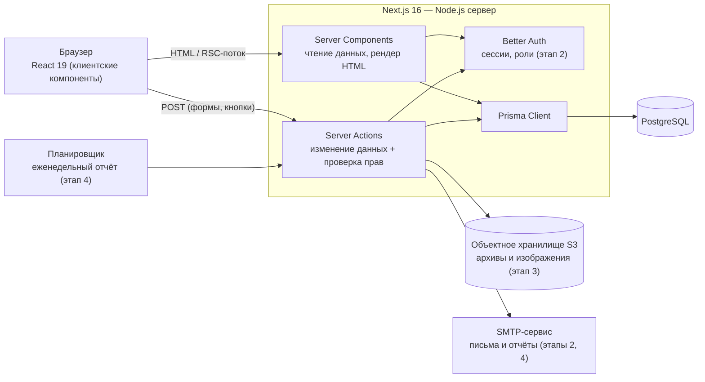
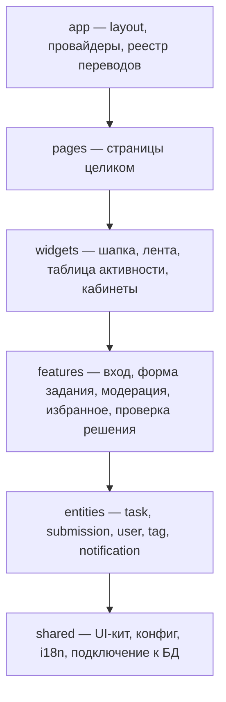

# 3. Архитектура

## 3.1 Общая схема

В версии из ВКР было три разнородные части: React-SPA, Supabase как облачный бэкенд и PHP-скрипты на хостинге. Здесь их заменяет **одно приложение Next.js**:

- **чтение данных** — Server Components: запрос к БД выполняется на сервере, браузер получает готовый HTML. Отдельный REST API не нужен, ключи доступа к базе в браузер не попадают;
- **изменение данных** — Server Actions: каждый action заново проверяет входные данные (zod), пользователя и его права (S-3, S-4);
- **база данных** — PostgreSQL через Prisma ORM: схема и миграции хранятся в репозитории;
- **файлы** — S3-совместимое хранилище (например, Timeweb Cloud S3) с приватным доступом;
- **почта и отчёты** — SMTP-сервис и задача по расписанию вместо `send_reports.php` и cron на виртуальном хостинге.

## 3.2 Развёртывание

| Окружение  | Состав                                                                                                                                                                |
| ---------- | --------------------------------------------------------------------------------------------------------------------------------------------------------------------- |
| Разработка | `bun dev` + локальный PostgreSQL через `prisma dev` (без Docker и установки СУБД)                                                                                     |
| Production | VPS в РФ (например, Timeweb Cloud): Node.js-приложение (`next build && next start` за nginx) + управляемый PostgreSQL или PostgreSQL на том же сервере + S3-хранилище |

Размещение в РФ закрывает требование 152-ФЗ о хранении персональных данных (S-7). Обычный виртуальный хостинг из ВКР не подходит: Next.js с Server Components и Server Actions требует запущенного Node.js-процесса.

## 3.3 Структура кода (Feature-Sliced Design)

Слой может импортировать только нижележащие слои; внутри слоя слайсы друг друга не импортируют. Правила проверяет `bun run lint:fsd` (Steiger), в CI — на каждый pull request.

## 3.4 Сравнение вариантов архитектуры

|                               | Supabase Cloud (ВКР)        | Self-hosted Supabase | **Next.js + Prisma + PostgreSQL**            |
| ----------------------------- | --------------------------- | -------------------- | -------------------------------------------- |
| Где лежат данные              | за рубежом                  | свой сервер          | свой сервер                                  |
| Логика прав                   | RLS-политики в SQL          | RLS-политики в SQL   | TypeScript в Server Actions + ограничения БД |
| Сколько сервисов поддерживать | 1 внешний + хостинг         | ~10 контейнеров      | 2–3 (приложение, БД, хранилище)              |
| Типобезопасность запросов     | частичная (генерация типов) | частичная            | полная (Prisma Client)                       |
| Порог входа                   | низкий                      | высокий              | средний                                      |

Выбран третий вариант: данные хранятся в РФ, получается одна кодовая база на TypeScript, а схема БД версионируется миграциями.
