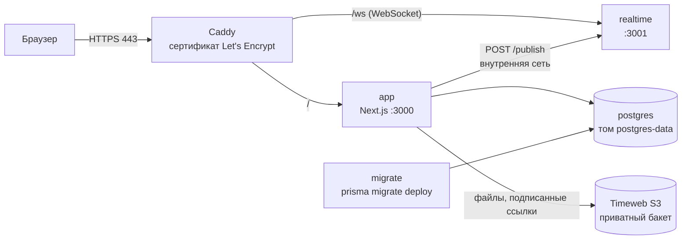

# 5. Развёртывание

Целевая схема — один VPS (например, Timeweb Cloud) с Docker Compose и файлы в Timeweb Cloud S3.



| Сервис   | Образ / цель Dockerfile | Что делает                                                        |
| -------- | ----------------------- | ----------------------------------------------------------------- |
| caddy    | `caddy:2-alpine`        | HTTPS, прокси на app и realtime, заголовки безопасности           |
| app      | `app`                   | Next.js в standalone-сборке, процесс не от root                   |
| realtime | `realtime`              | WebSocket: доставка событий (сообщения, уведомления)              |
| migrate  | `migrator`              | применяет миграции при каждом запуске и завершается; app ждёт его |
| postgres | `postgres:16-alpine`    | база, данные на томе                                              |

## 5.1 Что понадобится

- VPS с Ubuntu 22.04/24.04, 2 ГБ памяти (сборка Next требовательна к памяти; при 1 ГБ включите swap);
- домен и A-запись на IP сервера;
- бакет Timeweb Cloud S3 и SMTP-ящик.

## 5.2 Хранилище Timeweb Cloud S3

1. Панель Timeweb Cloud → «Хранилище S3» → создать бакет, тип **приватный**.
2. На странице бакета взять: endpoint (`https://s3.twcstorage.ru`), регион (`ru-1`), имя бакета, Access Key и Secret Key. Сверьте endpoint и регион с панелью — их и подставьте в `.env`.
3. Публичный доступ и CORS не нужны: файлы скачиваются по подписанным ссылкам (`X-Amz-Expires=60`), которые приложение выдаёт после проверки прав.

Перенос файлов, накопленных локально (`STORAGE_DRIVER=local`): ключ файла в БД совпадает с путём внутри `.storage`, поэтому достаточно скопировать папку в бакет с сохранением путей, например `rclone copy .storage timeweb:ИМЯ_БАКЕТА`.

## 5.3 Первый запуск

```bash
# на сервере
curl -fsSL https://get.docker.com | sh
git clone <репозиторий> internhub && cd internhub
cp .env.production.example .env
nano .env   # домен, пароли, секреты (openssl rand -base64 32), SMTP, S3
docker compose up -d --build
docker compose logs -f app
```

`migrate` применит миграции, после него стартует `app`; Caddy получит сертификат при первом обращении к домену.

**Первый администратор.** Сид в production не запускается. Зарегистрируйтесь как обычный пользователь, подтвердите почту, затем:

```bash
docker compose run --rm migrate bun run admin:make -- you@example.com
```

Через интерфейс роль не меняется — стать администратором можно только с доступом к серверу.

**Еженедельный отчёт** — cron на сервере (`crontab -e`), понедельник 9:00:

```cron
0 9 * * 1 curl -fsS -X POST -H "Authorization: Bearer СЕКРЕТ_ИЗ_CRON_SECRET" https://ДОМЕН/api/cron/weekly-reports
```

## 5.4 Обновление и резервные копии

```bash
git pull && docker compose up -d --build     # миграции применятся автоматически
docker compose exec postgres pg_dump -U internhub internhub | gzip > backup-$(date +%F).sql.gz
```

Резервную копию базы стоит снимать по cron и хранить вне сервера (например, в отдельном бакете S3). Файлы уже в S3.

## 5.5 Проверено и ограничения

- Docker-образы собираются в CI на каждый push (job `docker`): сборка трёх целей, smoke-тест realtime-контейнера, проверка `docker-compose.yml`.
- Standalone-сборка приложения проверена локально: `node .next/standalone/server.js` с реальной базой.
- Realtime-сервер — один экземпляр: соединения хранятся в его памяти. Для нескольких экземпляров нужна общая шина (Redis pub/sub). Так же устроен лимит частоты запросов (`shared/lib/rateLimit.ts`).
- S3-драйвер проверен юнит-тестами (подпись ссылок) — на реальном бакете проверьте загрузку и скачивание файла после первого запуска.
